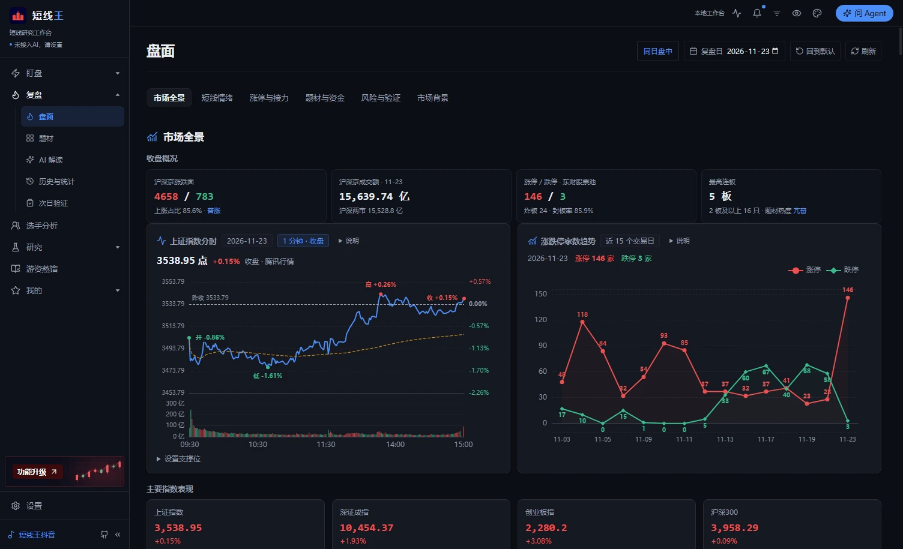

# 短线王 · A 股短线复盘工作台

短线王把 **4 个盯盘看板、5 个复盘看板和实盘比赛选手分析** 放在同一个本地工作台里。直接用你已登录且可正常对话的 **WorkBuddy 账号接入 AI，无需另填模型 API Key**。从竞价到收盘，你可以一路跟踪同一个题材，再请 AI 解释当天的变化，点开依据核对数字。

- **盯盘的 4 个看板**：市场动态、竞价与盘中、个股行情、市场资讯。在「竞价与盘中」沿已保存的 6 个时点回看，更容易分清强势股是开盘就弱，还是午后才回落。
- **复盘的 5 个看板**：盘面、题材、AI 解读、历史与统计、次日验证。其中「盘面」细分市场全景、短线情绪、涨停与接力、题材与资金、风险与验证、市场背景。「AI 解读」能从情绪、资金、题材、龙虎榜和龙头五个角度写收盘复盘，也能生成周报。

这个技能负责安装、打开工作台并验证 WorkBuddy 连接。进入后还可以围绕同一只股票开展 AI 多空辩论，把自己的思路写成条件做历史回测，或留到下一场收盘验证。

## 用一个判断走完两天的复盘

**盘中，看看分歧发生在什么时候。** 同样是昨日涨停股午后转弱，开盘就低开和早盘冲高后回落，反映的是两种走势。在「盯盘 → 竞价与盘中」查看昨日涨停股的竞价表现，再沿已保存的盘中快照对照涨停家数、炸板家数和封板率。错过快照的时点会标明缺失。

**收盘，拆开「今天很强」这句话。** 打开「复盘」里的连板天梯，从昨天的首板往今天的二板看：有几只晋级，哪几只炸板？再看题材页，把涨停个股与当天记录的涨停原因对上。这样写下来的复盘，能具体到哪一层梯队、哪一个题材发生了变化。

**次日，给昨晚的判断对一次账。** 比如，收盘后在「次日验证」记下「下个交易日，首板晋级二板的比例会上升」。次日 09:15 起原条件锁定，盘中可看暂时读数，收盘后核对结果。积累一段时间，再看近 60 个交易日的验证记录，你能分清哪些判断有过反复验证，哪些只留下了一次鲜明印象。

[查看更多实际界面，包括题材复盘与手机视图](https://github.com/Barryyangdong/Askill#界面预览)

## 选手分析：从比赛排名看到具体持仓

想知道某只股票是全场都爱持有，还是更多出现在领先选手的报单里？采集或导入你有权查看的同场比赛快照，选定交易日，对照排名、收益以及领先组和落后组的持有率。点进这只股票，就能查看已披露的持有人名单。有连续可比报单时，还能逐日区分新增、继续和退出持有。明细被遮挡或当天缺报时，页面会标明可用样本，避免把缺数据误读成选手已经卖出。

## 用游资历史案例练习自己的判断

在「游资蒸馏」挑一个历史案例，先根据当时的材料写下自己的判断，再揭晓结果、对照反例，检查自己是否理解了这种方法的适用条件。

## 从哪里开始

在 WorkBuddy 里说 **「启动短线王」** 即可。首次使用时，技能在这台电脑上安装并启动工作台，检查你现有的 CLI 授权。已有可用授权会直接复用；缺少授权时，国内个人账号在官方登录页扫码。完成授权后保持页面片刻，技能会自行验证 AI 连接、打开工作台，无需回到聊天里说“已登录”。系统可能要求你允许打开默认浏览器。首次安装依赖和获取行情需要联网。

个人成交、持仓、成本和盈亏保存在本机，工作台不会自动把这些记录发给模型。你在对话中输入的内容，以及主动选择交给 AI 识别的截图或表格，会发送给所选模型。研究页面提供市场事实、历史案例与验证记录，不提供买卖建议。

## WorkBuddy 执行说明

「启动应用」「启动短线王」都包含首次接入 AI。读取 @references/deployment.md，优先复用已有项目，完成必要的部署并启动本机服务。使用启动器的实际页面地址，按[标准部署流程](references/deployment.md)运行 `scripts/connect-workbuddy.mjs`。在同一次任务内等待该进程返回；工具提前返回会话 ID 时继续观察同一进程，不重开登录或要求用户回复确认。用户明确说只浏览、不接 AI 时才跳过接入。

本人扫码和系统授权提示在官方页面或系统界面完成。已经接入其他 AI 的浏览器沿用原配置，由用户决定是否切换。如遇取消、超时或当前环境限制，说明实际停在哪一步、给出可用的工作台地址。不要将已启动服务或浏览器打开等同于浏览器配置已保存。
